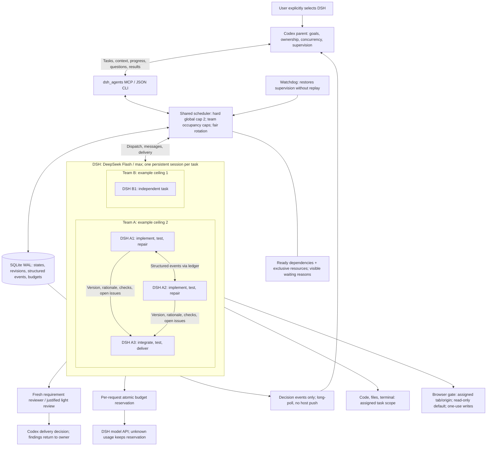

# DeepSeek Code Agent for Codex

English | [简体中文](./README.zh-CN.md)

**v0.5.0 status:** local **DeepSeek Harness (DSH)** is enabled only when the user explicitly selects it for the current task, with concurrent team support. The older OpenCode/Luna lane is still shipped, but only as an explicit legacy choice. Installing this plugin does not silently substitute OpenCode or Luna when the user asks for DSH.

The plugin gives Codex a `dsh_agents` MCP server, a `dsh-delegate` Skill, and the current DSH controller implementation: 8 daily collaboration tools (with legacy API compatibility), including parent delivery decisions and exact browser action grants, persistent sessions, selected-context packets, the `deepseek-official / deepseek-flash` model with `max` reasoning, optional current-Chrome control through huashu-chrome, and the legacy `deepseek_code_agent` MCP with its original `ds_*` tools.

There is **no claim of fixed token savings** for DSH. DSH is an external, independently persistent session with its own tools and history. Codex sends only the context the parent selects; DSH does not automatically inherit all private Codex tools, sessions, or conversation history. Older benchmark documents in this repository remain historical evidence for their original lanes and setups, not measurements of the current DSH lane.

## How collaboration works



The parent decides ordinary questions and corrections. A DSH `ask_parent` question is answered with `reply_agent` for that `request_id`; `send_message` is for additional context or a correction. Only a decision genuinely missing from the task goes to the user. DSH owns implementation, tests, fixes, and delivery; the parent reviews the result with the project's normal standards. Do not add a DSH-specific second full verification suite or force the parent to repeat every DSH test.

## Reliability

Tasks carry acceptance criteria and optional argv checks bound to explicit source fingerprints. Workers own repairs; integration owners handle integration failures. Codex decides delivery using existing evidence and proportionate review, without automatically rerunning tests or taking over implementation. A watchdog restores supervision without replay, task budgets stop repeated failures, and ready teams share slots by rotation. Browser calls go through an assigned-tab/origin gate; writes require an exact, expiring, single-use grant. This is a cooperative tool boundary, not an OS sandbox. [Configuration and limits](plugins/deepseek-code-agent/skills/dsh-delegate/references/reliability.md).

## What is included

- **`dsh_agents`** — explicitly selected DSH MCP server exposing `submit_work`, `observe_work`, `send_message`, `reply_agent`, `stop_work`, `authorize_browser_action`, `deliver_work`, `close_work`.
- **`dsh-delegate`** — explicit-only Skill for single-agent/team collaboration, current-Chrome work, and the same 8-tool contract.
- **DSH runtime** — `scheduler.py`, `worker.py`, `run_dsh.py`, `agent_api.py`, `context_packet.py`, `mcp_server.py`, the controller link, and `config/max.yml` under `plugins/deepseek-code-agent/skills/dsh-delegate/`.
- **Legacy lane** — the existing OpenCode controller (`server.mjs`, `ds_*` tools) and legacy Skill remain available for explicit OpenCode/Luna requests. The legacy Skill has implicit invocation disabled.
- **No bundled credentials** — no API keys, DSH/Codex session records, npm cache, user Chrome profile, cookies, or browser data.

## Requirements and platform status

| Requirement | Notes |
|---|---|
| Codex with plugin support | Install the marketplace and start a new task so MCP tools and Skills load. |
| Git | Required for the repository workflows and the legacy worktree lane. |
| Node.js 18+ | Runs the plugin launcher and MCP transport. |
| Python 3.9+ | Runs the bundled DSH controller. Set `DSH_PYTHON` for a non-default interpreter. |
| DeepSeek Harness | Install DSH separately. The default model is `deepseek-official / deepseek-flash` with `max` reasoning. |
| huashu-chrome 1.3.0 (optional) | Only for current-Chrome browser work. It is not auto-installed. |

Platform status is explicit:

- **macOS** — current real-use platform; the known working configuration is DSH `0.2.0-rc.2` and huashu-chrome `1.3.0`. The automated acceptance added with this package is offline only, using a fake DSH; this update did not add a real provider/model or Chrome live smoke test.
- **Linux** — offline and CI tests only. Real DSH model calls and the Chrome bridge have **not** been accepted on Linux; do a small local validation before relying on them.
- **Windows** — DSH execution is **not supported yet**. The preflight returns a structured `unsupported_platform` result instead of pretending cross-platform support. The legacy OpenCode lane can still be used separately if it works on that host.

## Install

```text
codex plugin marketplace add Fission21/deepseek-code-agent --ref main
codex plugin add deepseek-code-agent@deepseek-code-agent
```

Start a new Codex task after installation. Then run the offline check (it does not start a DSH model session or call a model; it may run `dsh --version`):

```bash
node <plugin-root>/dsh-server.mjs --check
# from this repository:
npm --prefix plugins/deepseek-code-agent run check
```

The check resolves DSH, Python, Node, the DSH runtime module root, and, when configured, huashu-chrome. It may invoke `dsh --version`, but it does not open a model session. Explicit paths are authoritative: an invalid `DSH_BIN`, `DSH_PYTHON`, `NODE_BIN`, or `HUASHU_CHROME_ENTRY` fails with a configuration error instead of falling back to another installation.

If DSH is installed somewhere unusual, configure it before starting Codex:

| Variable | Purpose |
|---|---|
| `DSH_BIN` / `--dsh` | DSH CLI executable |
| `DSH_PYTHON` | Python 3.9+ interpreter for the controller/MCP server |
| `NODE_BIN` | Node executable used by the huashu-chrome MCP bridge |
| `DSH_RUNTIME_ROOT` | Installed `@deepseek-ai` module directory for `controller_link` |
| `HUASHU_CHROME_ENTRY` / `--huashu-entry` | Installed huashu-chrome `src/cli.js` |
| `HUASHU_CHROME_VERSION` | Explicitly accept a different huashu-chrome version after checking it |

Do not put credentials in prompts, task files, repository files, or this plugin.

## Use DSH

Use DSH only when explicitly selected for this task. Configure one authorized shared budget before execution.

| Tool | Purpose |
|---|---|
| `submit_work` | Submit tasks; fresh requirement reviewers by default, or justified light review. |
| `observe_work` | List teams or wait for decisions/whole-team completion, using the returned cursor. |
| `send_message` | Correct the original owner; stopped tasks can use expected_revision. |
| `reply_agent` | Answer a pending question. |
| `stop_work` | Pause the team and stop its owned executions. |
| `authorize_browser_action` | Grant one exact authorized action. |
| `deliver_work` | Record the parent decision against current revisions and requirement review. |
| `close_work` | End collaboration and retain results. |

Global capacity defaults to 2 (configurable 1–8); team limits are ceilings within that pool. A single transaction claims one task only when all constraints permit. Old 18-operation API calls remain compatible; detailed diagnostics and capacity controls stay on the JSON CLI.

Every native model request reserves a conservative monetary bound atomically. Exhaustion stops dispatch and new requests; already reserved requests may finish. Missing/expired policy, unknown route or bounds deny dispatch. Unknown outcomes keep reservations. Accounting is an upper bound, not an invoice. Native web search/fetch bypass this model seam and are currently blocked; assigned huashu Chrome remains available. Runtime module changes require renewed transport-bound auditing.

A reviewer uses a new same-model session and the original criteria, not implementation history. Findings return to their owner; the parent arbitrates and decides delivery without routinely taking over repairs. Low-risk light review needs a reason. Observation is long-poll, not idle-host push: empty host timeouts can still cost model rounds. Watchdog restores supervision; uncertain worker effects pause without replay. There is no OS startup service or universal external-side-effect exactly-once guarantee.

See the [control contract](plugins/deepseek-code-agent/skills/dsh-delegate/references/control.md) for configuration and limitations.

### Defaults and context

- Model: `deepseek-official` / `deepseek-flash`, reasoning `max`, from `skills/dsh-delegate/config/max.yml`.
- `deepseek-flash` is a provider alias; the actual underlying version can change with DSH. Verify it after upgrades rather than promising a fixed version.
- The selected context is the task plus the explicit packet. The parent's full private Codex conversation is not transferred.
- DSH is a separate persistent session. It is not a Codex-internal model registration.
- The adapter stores collaboration records under `~/.local/share/dsh-delegate/agents` by default. Idle agents keep files, not a daemon; no background model process remains.

### Current Chrome (optional)

The browser chain is **DSH → browser_gate.py → huashu-chrome MCP → local shared bridge → the user's Chrome extension**. huashu-design is a design skill and does not provide this browser channel.

Pass an existing `tab_id` and its expected `url` to `spawn_agent`. DSH calls `learnings`, snapshots that exact tab, verifies identity, and passes the tab ID on every browser call. All tasks using the shared Chrome environment are serialized, even when they use different tabs. The parent must not operate that tab during the task.

Login state is not authorization. A DSH task may use the existing signed-in page only within the actions the user authorized; it may not pay, send messages, delete data, or write business records merely because the tab is logged in. `allowSensitive` applies only to a specific action already authorized. On `NO_EXTENSION`, stop and wait for the parent to confirm reconnection; on an uncertain write, verify before any retry and never repeat a possibly completed write.

## Legacy OpenCode/Luna lane

The old lane is still included for compatibility:

- MCP server: `deepseek_code_agent` with `ds_spawn_agent`, `ds_check`, `ds_verify_agent`, `ds_send_message`, `ds_wait_agent`, `ds_inspect_agent`, `ds_fork_agent`, `ds_interrupt_agent`, `ds_reply_agent`, `ds_list_agents`, `ds_close_agent`, and `ds_model_defaults`.
- Skill: `deepseek-coding-delegation`, now marked legacy and configured with `policy.allow_implicit_invocation: false`.
- It is used only when the user explicitly asks for OpenCode, the `ds_*` tools, or native Luna. An explicit DSH request must never be replaced by OpenCode or Luna.

The legacy prerequisite check is explicit:

```bash
npm --prefix plugins/deepseek-code-agent run check:legacy
```

The paid OpenCode live smoke test is explicit and is not part of the default DSH workflow:

```bash
npm --prefix plugins/deepseek-code-agent run test:legacy-live
```

Do not run it unless you intentionally want to exercise the legacy OpenCode provider and accept any quota cost.

## Safety model

- Codex keeps user-request interpretation, authorization, consequential decisions, and final acceptance.
- DSH owns bounded implementation, tests, routine fixes, and delivery. Its report is not acceptance by itself.
- No commit, push, merge, deploy, production-data write, credential export, or unrelated-file change is authorized by delegation alone.
- `scope_paths` bounds the assignment; it is not a security sandbox.
- The controller records and cleans only the process group it started for the current turn, after checking the recorded PID/PGID relationship and, when available, the DSH command. It does not kill shared services or unrelated tabs.
- The default state directory is private to the user; results and messages use restrictive permissions.
- No Chrome cookies, credentials, DSH sessions, npm caches, or personal data are included in this repository.

## Development and tests

The installable plugin is [`plugins/deepseek-code-agent`](./plugins/deepseek-code-agent). The repository root is also a Codex Git marketplace.

```bash
npm --prefix plugins/deepseek-code-agent test
npm --prefix plugins/deepseek-code-agent run check
```

`npm test` runs:

- the Python DSH suite: single-agent/team interfaces, concurrency ceilings and resource exclusion, versioned dependency handoffs, peer messages, scheduler recovery, MCP framing, lifecycle and process cleanup, queue/message boundaries, pending questions, interrupt/timeout resume, context packet limits, scope traversal, install-relative/special-character paths, and output filtering;
- the existing Node tests for the legacy OpenCode controller, verification, routing policy, MCP, and installation wiring.

The CI matrix runs on Ubuntu, macOS, and Windows. Linux/macOS exercise the DSH Python lifecycle with a fake DSH executable; Windows exercises the explicit unsupported-platform preflight plus the parts that do not require POSIX process groups. No test calls a real model or a provider API. The legacy paid live test is never run by CI.

Historical measurements are kept for auditability, not as current DSH evidence:

- [2026-09-14 token-routing benchmark](./docs/token-routing-benchmark-2026-09-14.md)
- [2026-09-15 task-routing pilot](./docs/task-routing-pilot-2026-09-15.md)
- [2026-09-15 reading-delegation retest](./docs/reading-delegation-retest-2026-09-15.md)
- [Queen token efficiency protocol](./docs/queen-token-efficiency.md)

Those documents describe their original OpenCode/Luna-era setups, single or limited runs, and stated limitations. They are not a DSH benchmark and do not promise token savings.

## License

[MIT](./LICENSE)
