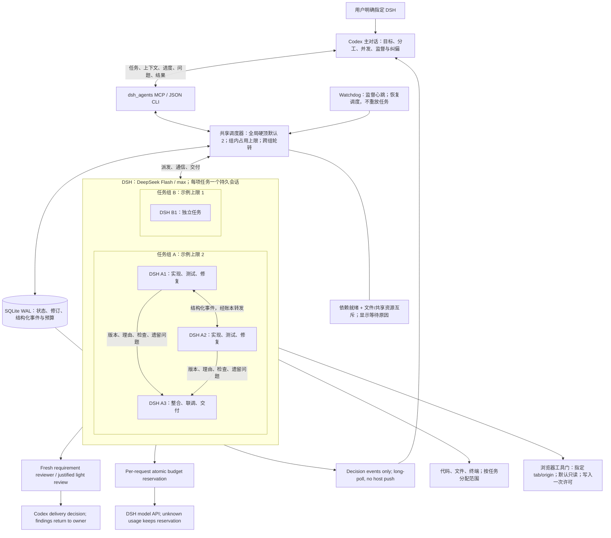

# DeepSeek Code Agent for Codex

[English](./README.md) | 简体中文

**v0.5.0 状态：** 本机 **DeepSeek Harness（DSH）** 仅在用户明确指定本次任务时启用，支持并发任务组。旧 OpenCode/Luna 通道仍保留，但只作为显式 legacy 选择；用户明确要求 DSH 时，安装本插件不会静默替换成 OpenCode 或 Luna。

插件提供 `dsh_agents` MCP、`dsh-delegate` Skill 和当前 DSH 控制器实现：8 个日常协作工具，兼容旧 API（含主对话交付记录与浏览器动作授权）、持久会话、显式上下文包、`deepseek-official / deepseek-flash` + `max` 推理、可选的当前 Chrome huashu 链路，以及保留的旧 `deepseek_code_agent` MCP 与 `ds_*` 工具。

本仓库**不声称 DSH 有固定省 token 收益**。DSH 是外部独立持久会话，有自己的工具和历史；Codex 只发送主对话选择的上下文，不会自动继承 Codex 的全部私有工具、会话或聊天历史。仓库里的历史 benchmark 只属于其原始通道和设置，不是当前 DSH 的实测。

## 合作方式



普通问题由主对话决定。DSH 通过 `ask_parent` 提出的问题要用 `reply_agent` 回答对应的 `request_id`；`send_message` 用于补充上下文或纠偏。只有任务中确实缺少的用户决定才问用户。DSH 负责实现、测试、修复和交付，主对话按项目正常标准审阅结果，不额外增加 DSH 专属的重复全套验证，也不要求主对话重跑 DSH 的每个测试。

## 可靠协作

验收标准随任务派发；最终命令由 runner 执行并绑定源码指纹。Worker 负责实现和修复，集成负责人处理联调，主对话判断交付并按需审阅关键改动，不默认重跑测试或替 Worker 补代码。默认失败两次或超出执行预算后升级给主对话。完整参数与边界见[可靠协作说明](plugins/deepseek-code-agent/skills/dsh-delegate/references/reliability.md)。

## 包含内容

- **`dsh_agents`**：显式选择 DSH 后使用，提供 `submit_work`, `observe_work`, `send_message`, `reply_agent`, `stop_work`, `authorize_browser_action`, `deliver_work`, `close_work`。
- **`dsh-delegate`**：关闭隐式触发，覆盖 DSH 单代理/团队协作、当前 Chrome 和同一套 8 个日常入口。
- **DSH 运行时**：`scheduler.py`、`worker.py`、`run_dsh.py`、`agent_api.py`、`context_packet.py`、`mcp_server.py`、controller link 和 `config/max.yml`，位于 `plugins/deepseek-code-agent/skills/dsh-delegate/`。
- **Legacy 通道**：原 OpenCode 控制器（`server.mjs`、`ds_*`）与旧 Skill 仍可用；旧 Skill 已关闭隐式触发。
- **不打包凭据**：不含 API key、Codex/DSH 会话记录、npm 缓存、用户 Chrome 配置、cookie 或浏览数据。

## 依赖与平台状态

| 依赖 | 说明 |
|---|---|
| 支持插件的 Codex | 安装后新开任务，让 MCP 工具和 Skill 加载。 |
| Git | 仓库工作流及旧 worktree 通道需要。 |
| Node.js 18+ | 插件启动器和 MCP transport 使用。 |
| Python 3.9+ | 内置 DSH 控制器使用；可用 `DSH_PYTHON` 指定解释器。 |
| DeepSeek Harness | 需单独安装；默认 `deepseek-official / deepseek-flash`，推理 `max`。 |
| huashu-chrome 1.3.0（可选） | 仅当前 Chrome 浏览器任务需要，不自动安装。 |

平台状态明确如下：

- **macOS**：当前真实使用平台；已知配置为 DSH `0.2.0-rc.2` 和 huashu-chrome `1.3.0`。本次交付新增的自动化验收仅为离线 fake DSH，未新增真实 provider/模型或 Chrome live smoke 验收。
- **Linux**：仅做离线/CI 测试；**未做真实 DSH 模型调用或 Chrome 链路验收**，首次使用前请自行做最小验证。
- **Windows**：DSH 执行暂不支持；预检返回结构化 `unsupported_platform`，不冒充跨平台已通过。旧 OpenCode 通道可在该主机单独使用（若其自身可用）。

## 安装

```text
codex plugin marketplace add Fission21/deepseek-code-agent --ref main
codex plugin add deepseek-code-agent@deepseek-code-agent
```

安装后新开一个 Codex 任务，然后运行离线预检（不启动 DSH 模型会话、不调用模型；可能执行 `dsh --version`）：

```bash
node <plugin-root>/dsh-server.mjs --check
# 在本仓库中：
npm --prefix plugins/deepseek-code-agent run check
```

预检会解析 DSH、Python、Node、DSH runtime 模块目录，以及已配置的 huashu-chrome。它可能执行 `dsh --version`，但不会打开模型会话。显式配置具有权威性：无效的 `DSH_BIN`、`DSH_PYTHON`、`NODE_BIN` 或 `HUASHU_CHROME_ENTRY` 会直接报配置错误，不会静默回退到另一个安装。

DSH 安装位置特殊时，可在启动 Codex 前配置：

| 变量 | 用途 |
|---|---|
| `DSH_BIN` / `--dsh` | DSH CLI 可执行文件 |
| `DSH_PYTHON` | 控制器/MCP 使用的 Python 3.9+ |
| `NODE_BIN` | huashu-chrome MCP 使用的 Node |
| `DSH_RUNTIME_ROOT` | 已安装的 `@deepseek-ai` 模块目录，供 `controller_link` 导入 |
| `HUASHU_CHROME_ENTRY` / `--huashu-entry` | huashu-chrome 的 `src/cli.js` |
| `HUASHU_CHROME_VERSION` | 核对后显式接受其他 huashu 版本 |

不要把凭据写进 prompt、任务文件、仓库文件或插件目录。

## 使用 DSH

仅在用户明确指定本次任务使用 DSH 时启用。新工作先绑定用户授权的共享预算。

| 工具 | 作用 |
|---|---|
| `submit_work` | 派发 tasks，默认追加新会话独立 reviewer；低风险 light 需要理由。 |
| `observe_work` | 列组或等待决策/全组完成；复用 cursor，普通进度静默。 |
| `send_message` | 纠偏给原 Worker； stopped 续接可带 expected_revision。 |
| `reply_agent` | 答复待处理问题。 |
| `stop_work` | 暂停全组并停止所属执行。 |
| `authorize_browser_action` | 发放确切动作的一次许可。 |
| `deliver_work` | 主对话依据当前修订与需求审阅记录交付。 |
| `close_work` | 结束协作并保留结果。 |

并发全局默认 2、可配置 1–8；组上限是全局池内的占用天花板。依赖、共享文件与 Chrome 冲突由调度器处理，数量由主对话根据可独立推进的工作决定。领取是一次事务，没有部分占位后等待另一额度。旧 18 项 API 仍兼容，完整状态和额度调整留在 JSON CLI。

预算在每次原生模型请求前原子预留，额度不足不再派新任务/发新请求；已预留请求可结束。缺少有效预算、价格或路由上界就拒绝。未决用量不退款，账本是保守上界而非发票。当前原生网页 search/fetch 未纳入这条请求链，会被拦截；花叔 Chrome 保留。DSH 模块升级需要重新确认已审计的请求边界。

独立 reviewer 使用同模型的新会话，从原始需求逐项判断；问题回原 Worker，主对话裁决，不默认接手修复。轻量任务允许有理由地省去独立 reviewer。observe_work 是长轮询，不是空闲宿主唤醒；空超时若触发主模型仍有费用。Watchdog 恢复调度，Worker 结果不明则暂停；没有 OS 开机托管或通用外部副作用重放保证。

完整参数、兼容说明和恢复语义见[控制与交付](plugins/deepseek-code-agent/skills/dsh-delegate/references/control.md)。

### 默认值与上下文

- 模型：`deepseek-official` / `deepseek-flash`，推理 `max`，来自 `skills/dsh-delegate/config/max.yml`。
- `deepseek-flash` 是提供商别名，实际底层版本可能随 DSH 更新；升级后请核实，而不是承诺固定版本。
- 上下文是任务加显式上下文包；不传输主对话的全部私有聊天记录。
- DSH 是独立持久会话，不是把 DSH 注册为 Codex 内部模型。
- 适配器默认把协作记录放在 `~/.local/share/dsh-delegate/agents`；空闲代理只保留文件，不保留后台守护进程。

### 当前 Chrome（可选）

链路是 **DSH → browser_gate.py → huashu-chrome MCP → 本机共享 bridge → 用户 Chrome 扩展**。huashu-design 是设计技能，不提供该浏览器通道。

`spawn_agent` 传入已分配的 `tab_id` 和预期 `url`。DSH 先 `learnings`，再 snapshot 该标签并核实身份，每次浏览器调用都带这个 tab ID。共享 Chrome 的浏览器任务串行执行，即使使用不同标签页；任务期间主对话不要操作该标签。

登录态不等于授权。DSH 只能在用户明确授权的动作范围内使用已登录页面，不能仅因页面已登录就支付、发消息、删除数据或写业务记录。`allowSensitive` 只适用于已经明确授权的具体动作。遇到 `NO_EXTENSION` 应停止并等主对话确认重连；写入结果不明时先核对，绝不重复可能已完成的写操作。

## Legacy OpenCode/Luna 通道

旧通道仍保留以兼容：

- MCP：`deepseek_code_agent`，提供 `ds_spawn_agent`、`ds_check`、`ds_verify_agent`、`ds_send_message`、`ds_wait_agent`、`ds_inspect_agent`、`ds_fork_agent`、`ds_interrupt_agent`、`ds_reply_agent`、`ds_list_agents`、`ds_close_agent`、`ds_model_defaults`。
- Skill：`deepseek-coding-delegation`，已标记 legacy，并配置 `policy.allow_implicit_invocation: false`。
- 只有用户明确要求 OpenCode、`ds_*` 或原生 Luna 时才使用。用户明确要求 DSH 时，绝不能用 OpenCode 或 Luna 替换。

旧前置检查需显式运行：

```bash
npm --prefix plugins/deepseek-code-agent run check:legacy
```

旧 OpenCode 付费 live smoke 同样需显式运行，不属于默认 DSH 流程：

```bash
npm --prefix plugins/deepseek-code-agent run test:legacy-live
```

除非你明确要验证旧 OpenCode provider 并接受配额消耗，否则不要运行。

## 安全边界

- Codex 保留用户需求解释、授权、关键决策和最终验收。
- DSH 负责有界实现、测试、普通修复和交付；它的自报不是验收。
- 委派本身不授权 commit、push、merge、部署、生产数据写入、凭据导出或修改无关文件。
- `scope_paths` 是任务边界，不是安全沙箱。
- 控制器只清理当前 turn 由它启动、且 PID/PGID 归属关系可核实的进程组；必要时再用 DSH 命令确认。不会杀共享服务或无关标签页。
- 默认状态目录属于当前用户，结果和消息使用受限权限。
- 仓库不包含 Chrome cookie、凭据、DSH 会话、npm 缓存或个人数据。

## 开发与测试

可安装插件位于 [`plugins/deepseek-code-agent`](./plugins/deepseek-code-agent)。仓库根同时是 Codex Git marketplace。

```bash
npm --prefix plugins/deepseek-code-agent test
npm --prefix plugins/deepseek-code-agent run check
```

`npm test` 运行：

- Python DSH 测试：单代理/团队接口、并发额度与互斥、阶段交接和过期版本、同组消息、调度器恢复、MCP framing、生命周期与进程清理、队列/消息边界、待答问题、中断/超时续接、上下文包上限、越界 scope、安装相对路径/特殊字符路径、输出过滤；
- 现有 Node 测试：旧 OpenCode 控制器、验证、路由策略、MCP 和安装接线。

CI 在 Ubuntu、macOS、Windows 上运行。Linux/macOS 用假 DSH 覆盖 DSH Python 生命周期；Windows 覆盖明确的“不支持运行”预检，以及不依赖 POSIX 进程组的部分。测试不调用真实模型或 provider API；旧付费 live 测试不会进入 CI。

历史测量保留用于审计，不是当前 DSH 证据：

- [2026-09-14 token-routing benchmark](./docs/token-routing-benchmark-2026-09-14.md)
- [2026-09-15 task-routing pilot](./docs/task-routing-pilot-2026-09-15.md)
- [2026-09-15 reading-delegation retest](./docs/reading-delegation-retest-2026-09-15.md)
- [Queen token efficiency protocol](./docs/queen-token-efficiency.md)

这些文档描述其原始 OpenCode/Luna 时代设置、有限次数运行和既定局限，不是 DSH benchmark，也不承诺省 token。

## License

[MIT](./LICENSE)
