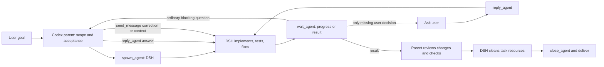

# DeepSeek Code Agent for Codex

Version 0.2.0. This plugin makes local **DeepSeek Harness (DSH)** the default external worker and keeps the previous OpenCode/Luna controller as an explicit legacy lane.

Full setup, platform status, security notes, and historical benchmark caveats are in the [repository README](../../README.md) ([中文](../../README.zh-CN.md)).

## What loads

- `dsh_agents` MCP from `.mcp.json` → `dsh-server.mjs` → `skills/dsh-delegate/scripts/mcp_server.py`
- `dsh-delegate` Skill with the default DeepSeek Flash/max workflow and current-Chrome guidance
- `deepseek_code_agent` MCP (legacy `ds_*` tools) and `deepseek-coding-delegation` Skill, explicit-only
- `config/max.yml` for `deepseek-official / deepseek-flash` with `reasoningEffort: max`

## Flow



The parent decides ordinary issues. `ask_parent` questions are answered with `reply_agent`; `send_message` is for corrections or additional context. Only a genuinely missing user decision goes to the user. DSH owns implementation and routine fixes. Do not add a DSH-specific duplicate full verification pass.

## Install and check

Install through the repository marketplace, start a new Codex task, then run the default offline check:

```bash
npm run check
# equivalent:
node ./dsh-server.mjs --check
```

`npm run check` is the DSH preflight. It may run `dsh --version`, but it does not open a DSH model session or call a model. A configured `DSH_BIN`, `DSH_PYTHON`, `NODE_BIN`, or `HUASHU_CHROME_ENTRY` is authoritative; invalid values fail with a configuration error and do not fall back.

The old OpenCode prerequisite check is explicit:

```bash
npm run check:legacy
```

## Platform status

- **macOS** — current real-use platform; known configuration DSH 0.2.0-rc.2 + huashu-chrome 1.3.0. Automated acceptance in this package is offline with a fake DSH; no new live provider/model or Chrome smoke test was added.
- **Linux** — offline/CI tests only; real DSH and Chrome acceptance has not been performed.
- **Windows** — DSH execution is unsupported; preflight returns `unsupported_platform` with a clear reason. The legacy OpenCode lane is separate.

## Use

Ask Codex to delegate to DSH, or explicitly invoke `$dsh-delegate`. The eight tools are `spawn_agent`, `send_message`, `wait_agent`, `inspect_agent`, `reply_agent`, `interrupt_agent`, `list_agents`, and `close_agent`.

- `scope_paths` is an assignment boundary, not an OS sandbox.
- `context_files` / `required_reads` are explicit text only: 64 KiB per file, 160 KiB per packet; no credentials or private Codex session logs.
- Timeout, interrupt, and controller errors pause without replaying an uncertain write. `send_message` resumes the same session.
- Pending questions wait up to 180 seconds; a timeout is not consent.
- State defaults to `~/.local/share/dsh-delegate/agents`; idle agents keep files, not a daemon.

## Browser

The optional chain is DSH → huashu-chrome MCP → shared local bridge → the user's Chrome extension. Pass `tab_id` and `url` to `spawn_agent`; DSH verifies and uses that exact tab on every call. Shared-tab operations are serialized. Login state is not business authorization; do not pay, send, delete, or write data without the exact task authorization.

## Legacy lane

`deepseek_code_agent` and `ds_*` remain for compatibility. `deepseek-coding-delegation` is marked legacy and has implicit invocation disabled in `agents/openai.yaml`. Use it only when the user explicitly selects OpenCode, `ds_*`, or Luna. Never substitute it for an explicit DSH request.

The paid legacy live smoke test is explicit-only and is not run by default or CI:

```bash
npm run test:legacy-live
```

## Tests

```bash
npm test          # Python DSH suite + existing Node/OpenCode tests
npm run test:dsh  # Python DSH suite only
npm run test:node # Node/OpenCode tests only
```

The DSH tests use a fake DSH executable and do not call a model. They cover the eight interfaces, MCP framing, lifecycle/process cleanup, queue and message boundaries, pending questions, interrupt/timeout resume, context limits, scope traversal, install-relative and special-character paths, and output filtering.
